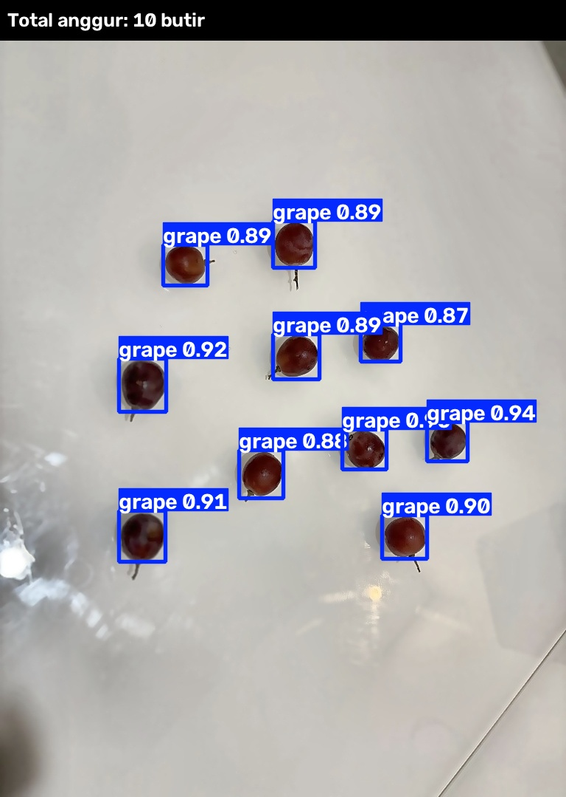

# CountVision: Deteksi dan Penghitungan Anggur dalam Satu Citra

Proyek mata kuliah **Pengenalan Citra Digital dan Computer Vision**. Sistem ini menghitung jumlah anggur merah-ungu dalam satu foto, dengan variasi posisi, jumlah, latar, dan pencahayaan.

**Metrik utama:** MAE penghitungan, Precision, Recall (ditambah F1 dan MAE relatif).

## Tim dan pembagian kerja

| Folder | Penanggung jawab | Isi |
|---|---|---|
| `M1/` | Aniza Helwa Mahanani | Akuisisi dan pelabelan data, EDA, preprocessing, segmentasi, penghitungan klasik (baseline) |
| `M2/` | Alyaa Rahma Nabilah | Ekstraksi fitur dan ML klasik |
| `M3/` | Ifka Rosmalita | Model DL (YOLO) dan prototipe |

## Struktur repositori

```
CountVision/
├── M1/    pengolahan citra dan baseline klasik (dijelaskan di bawah)
├── M2/    [diisi M2]
├── M3/    [diisi M3]
└── README.md
```

Foto dan dataset **tidak ada di repositori** karena ukurannya besar. Dataset dibagikan lewat Google Drive: [tautan Drive].

---

# Bagian M1: Akuisisi Data dan Pengolahan Citra

## Dataset

| Aspek | Isi |
|---|---|
| Foto dipakai | 108 (dua foto grayscale hasil edit dikeluarkan) |
| Scene independen | 51 (foto dari susunan anggur yang sama dihitung satu scene) |
| Domain | 33 foto buah lepas, 75 foto tandan (18 scene) |
| Latar | 11 jenis: putih glossy dan polos, piring ungu, handuk kuning dan peach, talenan kayu, meja kayu, granit gelap, batu abu, kain motif, meja gelap |
| Pencahayaan | merata 69, spotlight 35, redup 4 |
| Label | bounding box, satu kelas `grape`, 1.387 box (Roboflow, ekspor YOLO) |
| Aturan label | buah terlihat ≥ 50% dilabel; tangkai dan bayangan tidak ikut (`M1/labeling_rules.md`) |

**Pembagian data dilakukan per scene**, bukan per foto, supaya foto yang hampir kembar tidak terpecah ke dua split.

| Split | Foto | Scene | Rata-rata buah/foto | Maks |
|---|---|---|---|---|
| Train | 61 | 34 | 11,5 | 28 |
| Val | 23 | 8 | 11,3 | 21 |
| Test | 24 | 9 | 17,9 | 28 |

Daftar split ada di `M1/data/splits/split.csv`, dan atribut tiap foto (latar, pencahayaan, sudut, jarak, scene) di `M1/metadata.csv`.

## Pipeline final

```
foto -> resize (sisi terpanjang 1024 px) -> segmentasi HSV -> morfologi -> penghitungan B1 -> ROI (kotak per buah)
```

| Tahap | Metode | Parameter final |
|---|---|---|
| Resize | Interpolasi `INTER_AREA`, rasio aspek dijaga | sisi terpanjang 1024 px |
| Segmentasi | Threshold HSV, dua rentang hue (merah ada di dua ujung skala hue) | hue 0-12 dan 130-179, S ≥ 120, V ≥ 15 |
| Morfologi | Opening, closing, penutupan lubang kecil | opening 9 px, closing 7 px, lubang < 400 px² |
| **B0** | Connected components (satu gumpalan mask = satu buah) | `min_area` 1000 px² |
| **B1** | Distance transform, puncak lokal, watershed (memisahkan buah yang menempel) | jarak minimum 45 px, puncak minimum 10 px, `min_area` 1000 px² |

Konfigurasi final adalah **P0 + B1**.

## Protokol evaluasi

- Kotak prediksi dicocokkan satu-lawan-satu dengan label (IoU ≥ 0,5 dan ≥ 0,3).
- Parameter hanya di-tuning di **train**; val untuk membandingkan konfigurasi; **test dijalankan sekali** di akhir untuk konfigurasi final.
- Kriteria seleksi: F1@0,3. Seleksi dengan MAE saja ternyata menyesatkan (pecahan mask kecil terhitung sebagai buah dan menutupi kekurangan hitung di tandan padat), jadi F1 selalu dilaporkan bersama MAE.

## Hasil

**Baseline (B1 mengungguli B0)**

| | MAE val | F1@0,3 val | MAE test | MAE relatif test | F1@0,3 test |
|---|---|---|---|---|---|
| B0 | 5,44 | 0,51 | 10,46 | 0,585 | 0,324 |
| **B1** | **3,48** | **0,66** | **6,50** | **0,364** | **0,541** |

**Perbandingan preprocessing dan metode segmentasi (B1, data val; eksperimen eksploratif)**

| | Isi | MAE | F1@0,3 |
|---|---|---|---|
| **P0** | resize + HSV (final) | **3,48** | **0,662** |
| P1 | + Gaussian 5×5 | 3,65 | 0,621 |
| P2 | + CLAHE | 4,96 | 0,528 |
| P3 | + gamma 1,4, CLAHE, Gaussian | 3,96 | 0,569 |
| P4 | + gamma, CLAHE, bilateral, sharpening | 4,52 | 0,564 |
| Otsu | ambang otomatis pada kanal Saturation | 5,70 | 0,602 |
| K-means | klaster warna di ruang LAB (k=4) | 4,74 | 0,525 |

**Temuan utama**

1. Distance transform dan watershed memangkas MAE hampir separuh dibanding connected components saja.
2. Preprocessing klasik (CLAHE, gamma, filter) tidak memperbaiki penghitungan; CLAHE bahkan memperburuk foto spotlight. Gamma dan parameter CLAHE dipatok, tidak di-tuning.
3. HSV paling stabil antara train dan val; Otsu dan K-means membaik di train tetapi turun di val.
4. Kesalahan di test terkonsentrasi di tiga scene (sekitar 97% total error): **kurang hitung** pada tandan padat (kulit pucat dan buah gelap hilang dari mask) dan **kelebihan hitung** di piring ungu (dinding piring punya hue dan saturation mirip anggur).

**Keterbatasan:** val dan test kecil (8 dan 9 scene), beberapa kategori hanya satu scene, val dipakai berulang untuk keputusan desain sehingga angkanya sedikit optimis, dan test hanya dijalankan untuk konfigurasi final.

## Isi folder `M1/`

| File atau folder | Fungsi |
|---|---|
| `preprocess.py` | Resize, gamma, CLAHE, filter, segmentasi HSV (dan LAB), morfologi; `FINAL_CONFIG` |
| `counting.py` | Penghitungan B0 dan B1 |
| `evaluate.py` | MAE, Precision, Recall, F1, pencocokan IoU |
| `grape_pipeline.py` | Pipeline final `detect_grapes()` dan ekspor varian dataset untuk M3 |
| `tahap4_baseline.py` | Tuning di train, evaluasi val, mode `--test` |
| `tahap5_pipeline.py` | Perbandingan preprocessing P0-P4 |
| `tahap6_segmentasi.py` | Perbandingan Otsu dan K-means |
| `tahap1_*.py`, `tahap2_*.py`, `tahap3_*.py` | Penataan foto dan metadata, split, hitung jumlah GT, EDA |
| `metadata.csv`, `data/splits/split.csv`, `labeling_rules.md` | Metadata, pembagian data, aturan pelabelan |
| `data/labels/` | Label YOLO (file `.txt`) |
| `eda_output/`, `hasil_*/` | Gambar EDA dan hasil percobaan (CSV dan JSON) |

## Cara menjalankan

Semua perintah dijalankan **dari dalam folder `M1/`**, karena path bersifat relatif.

```powershell
cd M1
python -m venv venv
venv\Scripts\activate
pip install opencv-python numpy pandas matplotlib pillow scikit-image
```

Taruh data dari Google Drive di `M1/`: foto di `data/raw/` dan ekspor label YOLO (Roboflow) di `data/labels/yolo/`.

| Tujuan | Perintah |
|---|---|
| Tuning di train, evaluasi di train dan val | `python tahap4_baseline.py --space hsv` |
| Perbandingan preprocessing P0-P4 | `python tahap5_pipeline.py` |
| Perbandingan Otsu dan K-means | `python tahap6_segmentasi.py` |
| Ekspor varian dataset YOLO (untuk M3) | `python grape_pipeline.py --ekspor P0 P2 P3` |
| Evaluasi di test (**sekali saja**) | `python tahap4_baseline.py --space hsv --test` |

Mode `--test` menulis file kunci, sehingga tidak bisa dijalankan ulang tanpa sengaja. Jangan memakai test untuk memilih parameter atau model.

## Memakai pipeline dari kode lain

```python
import cv2
from grape_pipeline import detect_grapes

img = cv2.imread("foto.jpg")
boxes, mask = detect_grapes(img)      # boxes: (x1, y1, x2, y2) pada gambar yang sudah di-resize
print("Jumlah anggur:", len(boxes))

boxes_norm, _ = detect_grapes(img, normalized=True)   # kotak berskala 0-1
```

---

# Bagian M2: Ekstraksi Fitur dan Machine Learning Klasik

## Gambaran Umum

Bagian M2 melanjutkan hasil preprocessing dan segmentasi citra dari M1. Kandidat buah anggur yang diperoleh melalui pipeline segmentasi digunakan sebagai input untuk ekstraksi fitur dan klasifikasi menggunakan metode Machine Learning klasik.

Dua model yang diimplementasikan adalah **Support Vector Machine (SVM)** dan **Random Forest**. Tujuan eksperimen ini adalah membandingkan kemampuan kedua model dalam menyaring kandidat hasil segmentasi serta mengevaluasi pengaruhnya terhadap deteksi dan penghitungan buah anggur.

## Ekstraksi Fitur

Ekstraksi fitur dilakukan pada kandidat hasil segmentasi menggunakan tiga kelompok fitur:

| Jenis Fitur | Fitur yang Digunakan | Fungsi |
|---|---|---|
| Warna | Mean dan standar deviasi HSV | Menggambarkan karakteristik warna kandidat |
| Bentuk | Area, perimeter, circularity, aspect ratio, fill ratio | Menggambarkan karakteristik geometris kandidat |
| Tekstur | Histogram Local Binary Pattern (LBP) | Menggambarkan pola tekstur kandidat |

Setiap kandidat direpresentasikan menggunakan **21 fitur numerik**, terdiri dari 6 fitur warna, 5 fitur bentuk, dan 10 fitur tekstur LBP.

Hasil ekstraksi disimpan dalam `M2/results/features.csv`.

## Persiapan Dataset dan Pelabelan

Dataset menggunakan 108 gambar anggur dengan pembagian train, validation, dan test yang mengikuti dataset M1.

| Split | Jumlah Gambar | Anotasi Anggur | Kandidat Segmentasi |
|---|---:|---:|---:|
| Train | 61 | 699 | 594 |
| Validation | 23 | 259 | 213 |
| Test | 24 | 429 | 383 |
| **Total** | **108** | **1.387** | **1.190** |

Pelabelan awal kandidat dilakukan berdasarkan nilai Intersection over Union (IoU) antara bounding box hasil segmentasi dan anotasi ground truth.

| Label | Kriteria | Keterangan |
|---|---|---|
| 1 | IoU ≥ 0,5 | Kecocokan tinggi |
| 0 | IoU ≤ 0,1 | Kecocokan rendah |
| -1 | 0,1 < IoU < 0,5 | Ambigu |

Kandidat dengan label -1 tidak digunakan pada training awal.

Perlu diperhatikan bahwa label tersebut merupakan kategori kecocokan bounding box, bukan label anggur dan non-anggur yang telah diverifikasi secara manual. Kandidat dengan IoU rendah masih mungkin mencakup sebagian objek anggur.

Pemeriksaan visual awal dilakukan melalui `check_candidates.py` dan `prepare_dataset.py`, dengan hasil gambar pemeriksaan pada folder `M2/results/review/`.

## Implementasi Machine Learning

Dua metode Machine Learning digunakan untuk membandingkan hasil klasifikasi kandidat berdasarkan fitur yang telah diekstraksi.

| Model | Konfigurasi |
|---|---|
| Support Vector Machine (SVM) | StandardScaler, kernel RBF, C=1.0, class_weight=balanced |
| Random Forest | 100 decision tree, random_state=42, class_weight=balanced |

Training menggunakan **365 kandidat** berlabel 0 atau 1, sedangkan validation menggunakan **124 kandidat**.

Model dilatih menggunakan fitur warna, bentuk, dan tekstur tanpa memasukkan nilai IoU sebagai fitur input.

## Hasil Evaluasi Validation

Evaluasi validation dilakukan untuk mengukur kemampuan model mengklasifikasikan kategori kecocokan kandidat berdasarkan IoU.

| Metrik | SVM | Random Forest |
|---|---:|---:|
| Accuracy | 95,2% | **96,8%** |
| Precision | 96,6% | **98,2%** |
| Recall | 98,2% | 98,2% |
| F1-score | 97,4% | **98,2%** |

Random Forest memperoleh hasil validation sedikit lebih tinggi dibandingkan SVM.

Berdasarkan confusion matrix, SVM menghasilkan 6 kesalahan klasifikasi dari 124 kandidat, sedangkan Random Forest menghasilkan 4 kesalahan.

Visualisasi confusion matrix tersimpan pada:
- `M2/results/cm_svm.png`
- `M2/results/cm_rf.png`

Hasil ini merupakan evaluasi klasifikasi kategori IoU, bukan akurasi deteksi atau penghitungan buah anggur secara langsung.

## Evaluasi Deteksi dan Counting pada Data Test

Evaluasi dilakukan menggunakan **24 gambar test dengan total 429 anotasi buah anggur**.

Kedua model menerima kandidat dari pipeline segmentasi yang sama. Kandidat yang diprediksi sebagai kelas 1 oleh masing-masing model digunakan sebagai hasil deteksi.

Evaluasi dilakukan menggunakan:
- Precision, Recall, dan F1-score deteksi berdasarkan pencocokan bounding box satu-lawan-satu dengan IoU ≥ 0,5.
- Mean Absolute Error (MAE) Counting berdasarkan selisih absolut jumlah kandidat prediksi dan jumlah anotasi per gambar.

### Perbandingan SVM dan Random Forest

| Metrik | SVM | Random Forest |
|---|---:|---:|
| Precision Deteksi | 0,420 | **0,423** |
| Recall Deteksi | **0,289** | 0,287 |
| F1-score Deteksi | **0,343** | 0,342 |
| MAE Counting | **5,917** | 6,083 |

SVM menghasilkan MAE Counting paling rendah, yaitu 5,917 buah per gambar, sedangkan Random Forest menghasilkan precision deteksi sedikit lebih tinggi.

Perbedaan hasil validation dan test terjadi karena keduanya mengukur aspek yang berbeda. Validation mengukur klasifikasi kategori IoU, sedangkan evaluasi test mengukur kesesuaian lokasi dan jumlah objek yang terdeteksi.

Grafik perbandingan kedua model disimpan pada `M2/results/mae_comparison_ml.png`.

Hasil evaluasi tersedia pada:
- `M2/results/ml_results.csv`
- `M2/results/ml_test_evaluation.csv`
- `M2/results/test_evaluation.csv`
- `M2/results/counting_details.csv`

## Temuan dan Keterbatasan

1. Random Forest menunjukkan hasil lebih tinggi pada klasifikasi kategori IoU di validation set.
2. SVM menghasilkan rata-rata kesalahan counting sedikit lebih rendah pada data test.
3. Recall deteksi kedua model masih rendah karena kandidat dari tahap segmentasi awal belum sepenuhnya sesuai dengan anotasi.
4. Model Machine Learning hanya menyaring kandidat yang telah dihasilkan segmentasi, sehingga tidak dapat memulihkan objek anggur yang tidak terdeteksi sejak awal.
5. Pelabelan training masih berbasis IoU otomatis. Verifikasi label dan perbaikan kualitas kandidat diperlukan sebelum pengembangan model final.

Hasil eksperimen ini merupakan **baseline awal Machine Learning**, sehingga belum dapat dianggap sebagai performa akhir sistem penghitungan anggur.

## Isi Folder M2/

| File atau Folder | Fungsi |
|---|---|
| `feature_extraction.py` | Ekstraksi fitur HSV, bentuk, dan LBP serta penyusunan dataset fitur |
| `check_candidates.py` | Visualisasi sampel kandidat berdasarkan label IoU |
| `prepare_dataset.py` | Menyiapkan gambar dan CSV untuk pemeriksaan kandidat |
| `train_ml.py` | Training SVM dan Random Forest serta evaluasi validation |
| `evaluate_ml.py` | Evaluasi deteksi dan counting menggunakan data test |
| `results/features.csv` | Dataset fitur numerik |
| `results/dataset_stats.csv` | Statistik dataset dan kandidat |
| `results/ml_results.csv` | Hasil evaluasi klasifikasi validation |
| `results/cm_svm.png`, `cm_rf.png` | Confusion matrix kedua model |
| `results/svm_model.pkl`, `rf_model.pkl` | Model ML hasil training |
| `results/ml_test_evaluation.csv` | Evaluasi test khusus SVM dan Random Forest |
| `results/test_evaluation.csv` | Evaluasi test lengkap termasuk baseline segmentasi |
| `results/counting_details.csv` | Hasil penghitungan dan error per gambar |
| `results/mae_comparison_ml.png` | Grafik perbandingan MAE kedua model ML |
| `results/review/` | Gambar dan tabel pemeriksaan kandidat |

## Cara Menjalankan

Kode M2 memerlukan pipeline segmentasi dari M1 dan dataset hasil ekspor P0.

Pada implementasi saat ini, folder `M2/` berada di dalam direktori kerja M1, dengan struktur:

```text
M1/
├── preprocess.py
├── grape_pipeline.py
├── yolo_variants/
│   └── P0/
│       ├── train/
│       ├── valid/
│       └── test/
└── M2/
    ├── feature_extraction.py
    ├── train_ml.py
    ├── evaluate_ml.py
    └── results/
```

Instal dependensi:

```powershell
pip install opencv-python numpy pandas matplotlib scikit-image scikit-learn joblib
```

Jalankan perintah dari direktori M1:

```powershell
# 1. Ekstraksi fitur
python M2/feature_extraction.py

# 2. Pemeriksaan kandidat (opsional)
python M2/check_candidates.py
python M2/prepare_dataset.py

# 3. Training dan evaluasi validation
python M2/train_ml.py

# 4. Evaluasi deteksi dan counting
python M2/evaluate_ml.py
```

File hasil akan tersimpan pada folder `M2/results/`.

**Catatan integrasi:** Struktur direktori dalam repository kelompok menggunakan folder M1 dan M2 yang terpisah. Path pada kode M2 perlu disesuaikan dengan struktur repository final sebelum seluruh pipeline dijalankan dari root CountVision.

# Bagian M3: Model Deep Learning dan Integrasi Sistem

## Gambaran Umum

M3 mengembangkan model deep learning untuk mendeteksi dan menghitung buah anggur menggunakan **YOLO11n**. Model dilatih pada lima varian citra dari M1, yaitu P0–P4, untuk membandingkan pengaruh preprocessing terhadap kualitas deteksi dan penghitungan.

Pekerjaan M3 meliputi:

- Training YOLO11n pada setiap varian citra.
- Pemilihan confidence threshold menggunakan data validasi.
- Prediksi dan visualisasi seluruh 108 foto pada setiap varian.
- Evaluasi train, validasi, dan test secara terpisah.
- Analisis kesalahan deteksi dan penghitungan.
- Perbandingan hasil dengan baseline PCD dan Machine Learning.
- Integrasi preprocessing M1 dengan YOLO dalam prototipe penghitungan satu foto.

M1 menyediakan dataset berlabel dan fungsi preprocessing. M2 menggunakan fitur buatan tangan serta SVM dan Random Forest untuk menyaring kandidat segmentasi. M3 menggunakan citra dan anotasi bounding box untuk melatih YOLO, kemudian membandingkan hasilnya dengan pendekatan M2.

## Dataset dan Konfigurasi Training

Dataset menggunakan satu kelas, yaitu `grape`.

| Split | Jumlah Foto | Jumlah Anotasi |
|---|---:|---:|
| Train | 61 | 699 |
| Validasi | 23 | 259 |
| Test | 24 | 429 |
| **Total** | **108** | **1.387** |

Pembagian foto dan anotasi dibuat sama antarvarian. Seluruh 108 foto diprediksi menggunakan masing-masing model P0–P4 sehingga menghasilkan **540 gambar perbandingan anotasi dan prediksi**.

Hasil setiap split dilaporkan terpisah. Evaluasi train menggambarkan performa pada data yang digunakan selama pelatihan, validasi digunakan untuk pemilihan confidence, dan test digunakan untuk menilai performa pada data di luar pelatihan.

| Parameter | Konfigurasi |
|---|---|
| Model | YOLO11n |
| Bobot awal | `yolo11n.pt` pretrained |
| Epoch | 30 per varian |
| Ukuran input | `imgsz=640` |
| Batch size | 4 |
| Device | CPU |
| Workers | 0 |
| Seed | 42 |
| Bobot evaluasi | `P0_best.pt` sampai `P4_best.pt` |

Konfigurasi, metrik per epoch, dan grafik training tersedia pada `M3/training_logs/`.

## Varian Preprocessing

Varian citra mengikuti konfigurasi pada `M1/grape_pipeline.py` dan `M1/preprocess.py`.

| Varian | Preprocessing |
|---|---|
| P0 | Resize dengan sisi terpanjang maksimal 1024 piksel |
| P1 | Resize + Gaussian blur 5×5 |
| P2 | Resize + CLAHE |
| P3 | Resize + gamma correction + CLAHE + Gaussian blur |
| P4 | Resize + gamma correction + CLAHE + bilateral filter + sharpening |

Parameter tambahan:

- Gamma: 1,4.
- CLAHE: clip limit 2,0 dan tile 8×8.
- Bilateral filter: k=9.
- Sharpening: sigma 1,5 dan amount 0,7.

P0 menjadi baseline **raw image** dalam eksperimen ini, tetapi citra tetap sudah melalui resize dan ekspor JPEG. P1–P4 memperoleh pengolahan citra tambahan sebelum digunakan oleh YOLO.

Input YOLO berupa citra hasil preprocessing tanpa melalui segmentasi HSV atau watershed.

## Protokol Evaluasi

Pemilihan confidence dilakukan melalui `M3/evaluate_yolo.py`:

1. Memuat bobot model setiap varian.
2. Menguji confidence threshold 0,10–0,90 dengan interval 0,10 pada 23 foto validasi.
3. Memilih threshold dengan F1 tertinggi. Jika F1 sama, dipilih MAE lebih rendah.
4. Menggunakan threshold terpilih untuk evaluasi test.

Confidence yang diperoleh digunakan kembali pada `M3/prediksi_semua_foto.py` untuk memproses seluruh foto tanpa training ulang.

| Varian | Confidence |
|---|---:|
| P0 | 0,50 |
| P1 | 0,60 |
| P2 | 0,50 |
| P3 | 0,30 |
| P4 | 0,50 |

Bounding box prediksi dicocokkan dengan anotasi secara **satu-lawan-satu pada IoU ≥ 0,5**, dimulai dari pasangan dengan IoU tertinggi.

| Istilah | Pengertian |
|---|---|
| TP | Prediksi yang berhasil dicocokkan dengan anotasi |
| FP | Prediksi yang tidak memiliki pasangan anotasi |
| FN | Anotasi yang tidak memiliki pasangan prediksi |
| F1-score | Gabungan precision dan recall untuk menilai kualitas deteksi |
| MAE Counting | Rata-rata selisih absolut jumlah prediksi dan anotasi per foto |
| Foto dengan Jumlah Tepat | Foto dengan jumlah prediksi sama dengan jumlah anotasi |

Rumus yang digunakan:

```text
Precision = TP / (TP + FP)

Recall = TP / (TP + FN)

F1 = 2TP / (2TP + FP + FN)

MAE = Σ|jumlah prediksi − jumlah anotasi| / jumlah foto
```

F1 dihitung dari akumulasi TP, FP, dan FN dalam masing-masing split. Semakin tinggi F1 dan semakin rendah MAE, semakin baik hasilnya.

IoU NMS saat prediksi adalah **0,70**, sedangkan IoU untuk pencocokan evaluasi adalah **0,50**. NMS menyaring kotak prediksi yang bertumpuk, sementara pencocokan evaluasi membandingkan prediksi dengan anotasi.

## Hasil Prediksi Seluruh Foto

Hasil tersedia pada `M3/hasil_semua_foto/ringkasan_per_split.csv`.

| Model | Split | Jumlah Foto | F1-score | MAE (butir/foto) | Foto dengan Jumlah Tepat |
|---|---|---:|---:|---:|---:|
| P0 | Train | 61 | 97,83% | 0,361 | 46 |
| P0 | Validasi | 23 | 97,49% | 0,478 | 15 |
| P0 | Test | 24 | 97,24% | 0,583 | 11 |
| P1 | Train | 61 | 97,67% | 0,426 | 43 |
| P1 | Validasi | 23 | 96,88% | 0,435 | 17 |
| P1 | Test | 24 | 97,66% | 0,583 | 13 |
| P2 | Train | 61 | 97,90% | 0,410 | 43 |
| P2 | Validasi | 23 | 97,85% | 0,478 | 17 |
| P2 | Test | 24 | 98,95% | 0,375 | 15 |
| P3 | Train | 61 | 97,29% | 0,393 | 45 |
| P3 | Validasi | 23 | 98,08% | 0,348 | 17 |
| P3 | Test | 24 | 98,61% | 0,333 | 17 |
| **P4** | **Train** | **61** | **97,97%** | **0,328** | **45** |
| **P4** | **Validasi** | **23** | **98,64%** | **0,304** | **19** |
| **P4** | **Test** | **24** | **99,19%** | **0,125** | **21** |

P4 memperoleh F1 tertinggi dan MAE terendah pada ketiga split dalam eksperimen ini.

Namun, P4 tidak selalu menghasilkan jumlah foto dengan hitungan tepat terbanyak. Pada train, P0 menghasilkan 46 foto dengan jumlah tepat, sedangkan P4 menghasilkan 45 foto. MAE P4 tetap lebih rendah karena MAE memperhitungkan besar kesalahan pada seluruh foto.

Hasil train, validasi, dan test tidak digabung menjadi satu nilai performa pengujian.

## Hasil Deteksi pada Data Test

Evaluasi test mencakup **24 foto dengan 429 anotasi anggur**.

| Model | Confidence | F1-score | MAE (butir/foto) | TP | FP | FN |
|---|---:|---:|---:|---:|---:|---:|
| YOLO P0 | 0,50 | 97,24% | 0,583 | 422 | 17 | 7 |
| YOLO P1 | 0,60 | 97,66% | 0,583 | 417 | 8 | 12 |
| YOLO P2 | 0,50 | 98,95% | 0,375 | 424 | 4 | 5 |
| YOLO P3 | 0,30 | 98,61% | 0,333 | 427 | 10 | 2 |
| **YOLO P4** | **0,50** | **99,19%** | **0,125** | **426** | **4** | **3** |

Dibandingkan P0, F1 P4 meningkat sekitar **1,95 poin persentase**, sedangkan MAE turun dari **0,583 menjadi 0,125 butir/foto**.

MAE P4 sebesar 0,125 pada 24 foto berarti total selisih absolut jumlah prediksi dan anotasi adalah **3 butir**. Nilai ini berbeda dari total kesalahan deteksi, yaitu 4 FP dan 3 FN.

P3 memiliki MAE lebih rendah daripada P2, tetapi F1 sedikit lebih rendah. Hal ini menunjukkan bahwa ketepatan jumlah dan kualitas deteksi mengukur aspek yang berbeda.

## Perbandingan dengan PCD dan Machine Learning

Hasil gabungan tersedia dalam `M3/hasil_evaluasi_yolo/perbandingan_M1_M2_M3.csv`.

| Metode | F1 Deteksi pada IoU ≥ 0,5 | MAE (butir/foto) |
|---|---:|---:|
| PCD M1 melalui evaluator M2 | 30,54% | 6,583 |
| SVM | 34,25% | 5,917 |
| Random Forest | 34,17% | 6,083 |
| YOLO P0 | 97,24% | 0,583 |
| YOLO P4 | 99,19% | 0,125 |

Pada pengujian ini, YOLO menghasilkan kualitas deteksi dan penghitungan lebih tinggi dibandingkan baseline klasik.

SVM dan Random Forest hanya menyaring kandidat dari tahap segmentasi. Objek yang tidak muncul sebagai kandidat tidak dapat dipulihkan oleh kedua model tersebut. YOLO memprediksi lokasi objek langsung dari citra.

**Catatan:** hasil PCD pada tabel berasal dari evaluator M2 dengan IoU ≥ 0,5, sehingga berbeda dari eksperimen M1 yang melaporkan F1@0,3. Hasil klasifikasi kandidat pada validation M2 juga mengukur aspek berbeda dari F1 deteksi pada tabel ini.

## Analisis Kesalahan

Pada P4, sebanyak **21 dari 24 foto test (87,5%)** memiliki jumlah prediksi tepat. Sebanyak **19 dari 24 foto** tidak memiliki FP maupun FN pada batas IoU 0,5.

Lima foto berikut masih memiliki kesalahan deteksi:

| Foto | Anotasi | Prediksi | Error Counting | TP | FP | FN |
|---|---:|---:|---:|---:|---:|---:|
| grape_034 | 6 | 7 | 1 | 6 | 1 | 0 |
| grape_098 | 28 | 27 | 1 | 27 | 0 | 1 |
| grape_099 | 28 | 28 | 0 | 27 | 1 | 1 |
| grape_100 | 28 | 28 | 0 | 27 | 1 | 1 |
| grape_102 | 28 | 29 | 1 | 28 | 1 | 0 |

grape_034 dan grape_102 mengalami kelebihan hitung satu butir, sedangkan grape_098 mengalami kekurangan hitung satu butir.

Pada grape_099 dan grape_100, jumlah prediksi sesuai anotasi, tetapi masing-masing memiliki satu FP dan satu FN. Kedua kesalahan saling menutupi dalam penghitungan jumlah.

FP dan FN dapat muncul akibat prediksi tambahan, objek yang terlewat, atau ketidaksesuaian lokasi dan ukuran kotak sehingga tidak memenuhi IoU 0,5. Penyebab spesifik memerlukan pemeriksaan pasangan kotak yang tidak cocok.

Contoh ini menunjukkan bahwa **jumlah prediksi yang tepat belum menjamin seluruh deteksi tepat**, sehingga MAE counting digunakan bersama F1-score deteksi.

Visualisasi seluruh foto menampilkan anotasi di sebelah kiri dan prediksi di sebelah kanan, disertai jumlah anotasi, prediksi, error absolut, TP, FP, dan FN.

## Prototipe Penghitungan

Prototipe pada `M3/demo.py` memproses satu foto menggunakan model P4 dengan alur:

```text
Foto → preprocessing P4 → YOLO11n → penyaringan deteksi
→ penghitungan bounding box → gambar dan jumlah prediksi
```

Prototipe menggunakan confidence 0,50, IoU NMS 0,70, ukuran input 640, dan CPU.

Pada contoh `grape_006`, prototipe menghasilkan 10 deteksi, sesuai dengan jumlah anotasi.



## Isi Folder M3

| File atau Folder | Fungsi |
|---|---|
| `evaluate_yolo.py` | Pemilihan confidence pada validasi dan evaluasi test P0–P4 |
| `prediksi_semua_foto.py` | Prediksi, evaluasi, dan visualisasi seluruh 108 foto per varian |
| `demo.py` | Preprocessing P4 dan penghitungan anggur pada satu foto |
| `analisis_semua_foto.md` | Dokumentasi analisis hasil seluruh foto |
| `models/P0_best.pt`–`P4_best.pt` | Bobot model hasil training |
| `training_logs/P0/`–`P4/` | Konfigurasi, metrik per epoch, dan grafik training |
| `hasil_evaluasi_yolo/P*_validasi.csv` | Hasil setiap confidence pada validasi |
| `hasil_evaluasi_yolo/P*_test_per_foto.csv` | Hasil evaluasi test per foto |
| `hasil_evaluasi_yolo/ringkasan_test.csv` | Ringkasan test seluruh varian |
| `hasil_evaluasi_yolo/perbandingan_M1_M2_M3.csv` | Perbandingan PCD, ML, dan YOLO |
| `hasil_semua_foto/ringkasan_per_split.csv` | Ringkasan lima varian pada tiga split |
| `hasil_semua_foto/P*/train/` | Gambar hasil dan CSV per foto train |
| `hasil_semua_foto/P*/valid/` | Gambar hasil dan CSV per foto validasi |
| `hasil_semua_foto/P*/test/` | Gambar hasil dan CSV per foto test |
| `demo_output/` | Gambar keluaran prototipe |

Setiap folder split pada `hasil_semua_foto/` berisi `hasil_per_foto.csv` dan gambar perbandingan anotasi dengan prediksi setelah skrip dijalankan.

Gambar lengkap dihasilkan secara lokal. Unggahan kode dan CSV tidak otomatis menyertakan seluruh gambar hasil.

## Cara Menjalankan

Perintah berikut menggunakan **PowerShell dari root repository CountVision**, yaitu direktori yang berisi folder `M1`, `M2`, dan `M3`.

### 1. Siapkan Environment

Jika belum memiliki environment, jalankan:

```powershell
python -m venv .venv
.\.venv\Scripts\python.exe -m pip install ultralytics==8.4.213 opencv-python numpy
```

Jika environment sudah tersedia, gunakan environment tersebut.

### 2. Siapkan Dataset

Letakkan dataset P0–P4 pada:

```text
CountVision/yolo_variants/
```

Setiap varian memiliki folder `train`, `valid`, dan `test`, masing-masing berisi `images` dan `labels`.

Kode evaluasi membaca dataset dari `CountVision/yolo_variants/`. Jika hasil ekspor M1 berada di `M1/data/yolo_variants/`, sesuaikan lokasi dataset dengan path tersebut.

Pastikan bobot `P0_best.pt` sampai `P4_best.pt` tersedia di `M3/models/`.

### 3. Pemilihan Confidence dan Evaluasi Test

```powershell
.\.venv\Scripts\python.exe .\M3\evaluate_yolo.py
```

Hasil tersimpan pada `M3/hasil_evaluasi_yolo/`.

### 4. Prediksi Seluruh Foto

```powershell
.\.venv\Scripts\python.exe .\M3\prediksi_semua_foto.py
```

Program memproses 108 foto untuk setiap varian menggunakan bobot yang sudah dilatih dan confidence yang ditetapkan dalam kode berdasarkan hasil validasi.

Keluaran berupa:

- 540 gambar perbandingan anotasi dan prediksi.
- 15 CSV hasil per foto, masing-masing untuk satu kombinasi varian dan split.
- Satu `ringkasan_per_split.csv` berisi 15 baris ringkasan.

Seluruh hasil tersimpan di `M3/hasil_semua_foto/`. Proses ini tidak melakukan training ulang. Menjalankan ulang skrip akan menimpa file keluaran dengan nama yang sama.

### 5. Demo Satu Foto

Agar demo dapat mengimpor fungsi preprocessing M1, jalankan:

```powershell
$env:PYTHONPATH = (Resolve-Path .\M1).Path
```

Pengaturan berlaku untuk sesi terminal tersebut.

Untuk foto asli JPG atau PNG, ganti path dengan lokasi foto yang tersedia:

```powershell
.\.venv\Scripts\python.exe .\M3\demo.py "C:\lokasi\foto_anggur.jpg"
```

Demo menerapkan preprocessing P4 sebelum prediksi.

Untuk foto yang sudah diproses menjadi P4, gunakan `--sudah-p4`:

```powershell
.\.venv\Scripts\python.exe .\M3\demo.py ".\yolo_variants\P4\test\images\grape_006_jpg.rf.49e9c296ee6b6acb644568a30ebd490f.jpg" --sudah-p4
```

Hasil berupa jumlah prediksi di terminal dan gambar pada `M3/demo_output/`.

## Temuan dan Keterbatasan

1. Seluruh 108 foto berhasil diproses pada lima varian, menghasilkan 540 visualisasi dengan hasil train, validasi, dan test yang terpisah.
2. P4 memperoleh F1 tertinggi dan MAE terendah pada ketiga split dalam eksperimen ini.
3. Jumlah prediksi yang tepat tidak selalu berarti seluruh kotak deteksi sesuai anotasi.
4. Perbandingan paket preprocessing belum mengisolasi kontribusi setiap operasi, sehingga peningkatan P4 tidak dapat dikaitkan hanya dengan satu filter.
5. Dataset test terdiri dari 24 foto. Hasil belum menjamin performa yang sama pada varietas anggur, latar, kamera, atau pencahayaan baru.
6. Eksperimen menggunakan satu seed dan belum diulang untuk mengukur variasi hasil training.
7. P4 digunakan dalam demo setelah hasil perbandingan diamati. Eksperimen konfirmatori berikutnya perlu menetapkan pilihan model berdasarkan validasi dan mengujinya pada data baru yang belum digunakan untuk keputusan desain.
8. Prototipe interaktif masih berupa pemrosesan satu foto melalui terminal, sedangkan pemrosesan seluruh dataset dilakukan melalui skrip batch.

---

